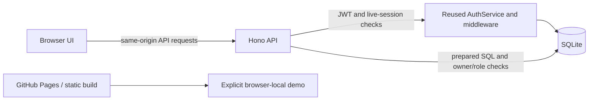

# SwopBlog architecture

The Node HTTP adapter serves the original frontend from a strict public asset allowlist, chooses shared-mode configuration, bounds request bodies and forwards API requests to Hono. The shared mode has no dependency on the demo's browser storage. `config.js` remains demo-only in the static artifact. No backend database or key is copied by the build.

## Original JWT project reused

Source: [Swopnab/JWT-auth-service-plus-RBAC](https://github.com/Swopnab/JWT-auth-service-plus-RBAC), tested branch commit `aab27b7f0d90658b676b1ab6bd3223287c5a299a`.

Adapted modules: `api/src/services/auth.service.js`, `user.service.js`, `middleware/auth.js`, `middleware/rateLimit.js`, `utils/crypto.js`, `utils/errors.js` and `config.js`. The original account/role/session schema and token-hardening migrations are included. Unrelated job, music/favorites, email delivery and cloud deployment routes/configuration are not brought into this project.

Changes for SwopBlog: JWT issuer/audience are pinned; the Node adapter supplies trusted connection IP; the account router moves refresh tokens to a same-origin HttpOnly cookie; registration creates a blog profile and never grants elevated roles. The SQLite adapter implements the prepared-statement interface these modules use. This reuses the actual authentication code while letting the app run without a hosted D1 database or cloud credentials. It does not share existing account databases or signing keys with the original repo.

## Records and boundaries

- `users`, `roles`, `user_roles`, `sessions`, `refresh_tokens`: credentials, permissions and revocation.
- `blog_profiles`: user-owned display name/bio/avatar; public post output contains no email or password hashes.
- `blog_posts`: author ID, title/body/category, draft/published state, timestamps and edit revision.
- `blog_comments`: parent post ID and authenticated author ID; deletion permission is author or moderator/admin.
- `blog_likes`: composite `(post_id,user_id)` primary key, making repeated likes idempotent.
- `rate_limits`: persistent per-route, per-connection-IP fixed-window counts.
- `schema_migrations`: migration ledger prevents repeat application of session-invalidating migrations.

Public feeds include published records only. Mine/drafts scopes require authentication and are filtered by the live user. Supplied owner IDs are ignored. A moderator can delete public content but cannot edit other users' work or see private drafts. Foreign keys remove replies/likes when a post is removed. A conditional post revision update returns 409 for stale edits.

API output provides permission flags to guide controls; the server independently enforces permissions. Search parameters are bound SQL values. Feed/comment cursors are bounded integer IDs; each page contains at most 20 records. Text renders literally. The Node server serves only known public assets, so filesystem paths cannot expose `.data`, API source or environment files.

## Evidence and future deployment

Tests demonstrate isolated SQLite correctness and small multi-browser workflows, not large-community throughput or complete security assurance. Before deployment, select a host with persistent Node/SQLite storage or adapt to a managed database, use HTTPS, configure exact origins and trusted proxy IPs, establish backups and moderation, and review hosting/email costs with the owner. No cloud resources are created by setup, tests or CI.
